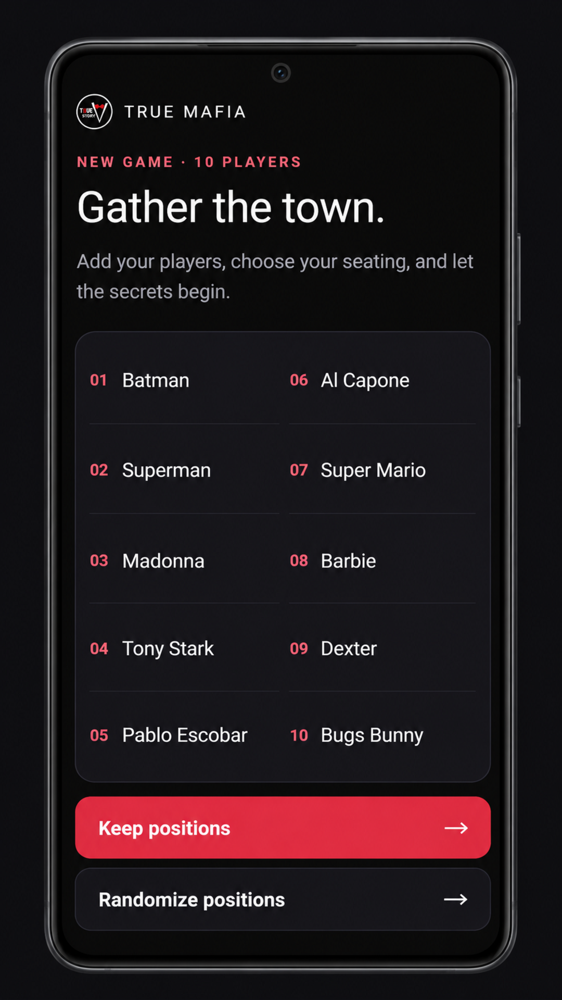
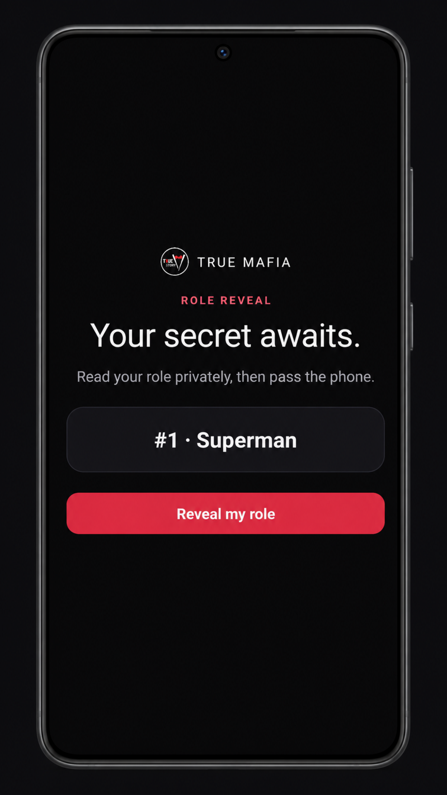
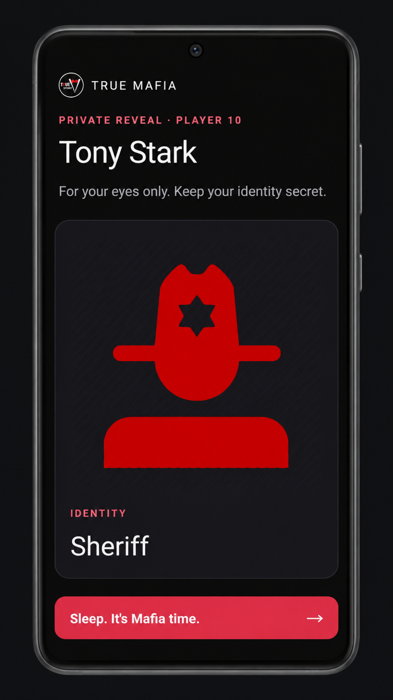
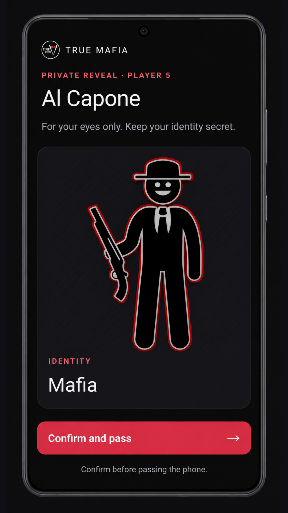

# True Mafia

<p align="center">
  
</p>

**A pass-the-phone companion for the social deduction game Mafia.**

True Mafia guides a ten-player game through private role reveals, narrated night phases, Mafia votes, and investigations. Built with React Native, it combines native audio playback with a responsive black-and-red interface.

[Download the Android APK](https://github.com/giarous/true-mafia-v2/raw/refs/heads/main/releases/true-mafia-v2.apk) · [Android build guide](android/README.md)

## Screenshots

Framed app previews in 9:16 format. The dark Mafia figure has an added outline for visibility.

| Player setup | Private role hand-off |
| :---: | :---: |
|  |  |
| **Sheriff identity** | **Mafia identity** |
|  |  |

## Features

- Ten-player setup with custom names and optional randomized seating.
- Private role assignment: one Sheriff, one Don, two Mafia, and six Citizens.
- Audio-guided phases with automatic transitions during the opening Mafia round.
- Night-time victim selection and investigations, followed by narrated results.
- Responsive layouts that fit the screen without scrolling.
- A standalone Android APK with bundled narration and JavaScript; no server or account required.

The visible app name is **True Mafia**. Its Android application ID is `com.truemafia.v2`, allowing installation alongside the original app.

## How to play

1. Gather ten players, enter their names, and choose whether to randomize seating.
2. Pass the phone around the table so each player can privately reveal and confirm their role.
3. Follow the opening Mafia-phase narration, then begin the daytime discussion.
4. Pass the phone for night actions: Mafia choose a victim, while the Sheriff and Don investigate.
5. Review the next morning's result and continue the discussion/night cycle.

Seat numbers on screen start at one. The Don appears as Mafia in investigation results. Discussion, voting outside the app, and deciding the final game outcome remain player-led.

## Development

The JavaScript app uses React 16.8, React Native 0.60, and React Navigation 4. The Android build targets **Android 14 / API 34** using Android Gradle Plugin 8.2.2 and Gradle 8.5.

Use **Node 16.20.2** and **Yarn 1.22.22** with this existing dependency set:

```bash
yarn install --frozen-lockfile --non-interactive
yarn start
```

Metro serves the development bundle for a native app, rather than a webpage. Android builds also require a JDK and Android SDK; see the [Android build guide](android/README.md). iOS native builds require macOS and Xcode and are not currently validated here.

### Validation

```bash
yarn test --runInBand --watch=false
yarn lint
```

Tests cover app startup, name entry, navigation parameters, player selection, role distribution, investigation privacy, responsive layouts, and the original audio timing. Native audio and wake-lock bindings are mocked in JavaScript tests; verify playback and layout on a device before distributing a release.

## Project structure

| Path | Responsibility |
| --- | --- |
| `App.js` | Navigation graph and entry route |
| `screens/` | Setup, private reveals, night actions, and round transitions |
| `game/` | Shared roster/shuffle helpers, role artwork, and audio utilities |
| `ui/` | Theme, responsive screen layout, cards, buttons, and player picker |
| `resources/` | Shared artwork |
| `android/` | Android application, bundled narration, and native-module build adapters |
| `ios/` | iOS application and native assets |
| `__tests__/` | UI, game-helper, startup, and timed-round regression tests |
| `releases/` | Downloadable Android APK and build details |

## Implementation notes

- The phone is handed between players. Navigation uses replacement routes to avoid exposing a previous player's private screen through the back stack.
- Navigation parameters preserve the original string values for Mafia consensus and zero-based indices for investigations. UI seat numbers are one-based.
- The opening Mafia phase follows a fixed 90-second narration schedule. Keep timing changes synchronized with the audio assets.
- Role images and loading/playback errors are handled centrally; private player roles and choices are not written to debug logs.
- The current APK uses a test signing key. A production release needs a private signing key; keystores and local SDK configuration are excluded from version control.
